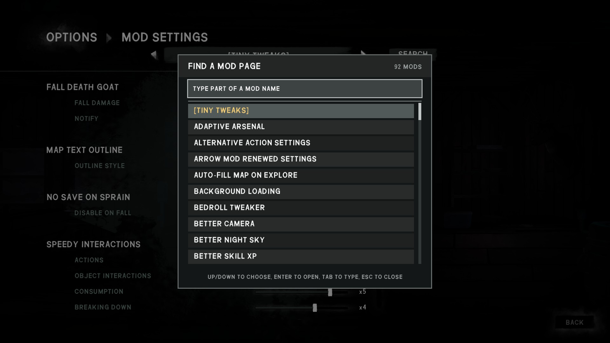

# Mod Settings Search

Got so many mods that finding one in Mod Settings takes a dozen arrow clicks? Mod Settings Search is here to help!

Mod Settings Search is a mod for The Long Dark that adds a search to the Mod Settings screen. Click **Search** next to the mod picker, type a few letters, and pick the mod from the list to jump straight to its settings page.



## Features

- A **Search** button next to the mod picker on Options > Mod Settings, plus a Ctrl+F shortcut that works from the main menu, the pause menu and any Options tab.
- A popup with a search box and a scrollable list of every mod that has a settings page (mods whose settings are all hidden are left out, the same as in the picker).
- The list is in the same order as the mod picker and opens with the list active, so arrow keys and Enter work straight away. Press Tab or click the search box to type.
- The list narrows as you type. Names that start with your text come first, and spaces are ignored, so `itemweight` finds "Item Weight Tweaker".
- The page you are on is shown in gold, and the list starts on it.
- Choosing a mod switches pages through the normal mod picker, so ModSettings behaves exactly as if you had clicked the arrows.
- Game and mod hotkeys are switched off while the popup is open, so typing a letter won't also trigger another mod's keybind.
- Esc (or controller B) closes only the popup, not the options menu. Clicking outside the popup also closes it.
- Uses the game's own fonts with a solid, opaque popup that fits the menu.

## Controls

| Action | Keyboard / mouse | Controller |
| --- | --- | --- |
| Open the search | Click **Search**, press Enter on the mod picker row, or press Ctrl+F (also works from the main menu, the pause menu and any Options tab, and takes you straight to Mod Settings) | Press A on the mod picker row |
| Filter the list | Press Tab or click the search box, then type (the popup opens with the list active, not the box) | - |
| Move through the list | Up/Down, Page Up/Page Down, mouse wheel, drag the scroll bar or click above/below it | D-pad / left stick |
| Open the highlighted mod | Enter, or click a name | A |
| Switch between the search box and the list | Tab | - |
| Clear the search | Click the **X** in the search box | - |
| Close the popup | Esc, or click outside it | B |

## Requirements

- The Long Dark (tested on v2.60)
- MelonLoader v0.7.2
- ModSettings

## Installation

1. Install MelonLoader v0.7.2 for The Long Dark if you have not already.
2. Install ModSettings if you have not already.
3. Copy the `ModSettingsSearch` folder into your game's `Mods` folder (for example, `E:\SteamLibrary\steamapps\common\TheLongDark\Mods`), so it looks like this:

   ```
   TheLongDark
   └── Mods
       └── ModSettingsSearch
           ├── ModSettingsSearch.dll
           └── manifest.json
   ```

   MelonLoader only loads a mod in a subfolder when `manifest.json` is next to the DLL, so keep both files together.
4. Launch the game.

## Credits

- Hinterland Studio for creating this amazing game
- DigitalzombieTLD for [ModSettings](https://github.com/DigitalzombieTLD/ModSettings), which this mod adds to
- Other TLD modders for inspiration and reference materials
- The TLD Modding Discord server for guidance, testing, and feedback
- Modding Framework and Libraries: MelonLoader, Harmony (HarmonyLib), Il2CppInterop, and ModSettings

## Building from Source

1. Clone or open the project in Visual Studio / .NET SDK targeting `net6.0`.
2. Update `TLDPath` in `src/ModSettingsSearch/ModSettingsSearch.csproj` to point to your The Long Dark installation directory (currently set to `E:\SteamLibrary\steamapps\common\TheLongDark`).
3. Build the project so references from `$(TLDPath)\MelonLoader\net6\*.dll` and `$(TLDPath)\MelonLoader\Il2CppAssemblies\*.dll` resolve, along with `$(TLDPath)\Mods\ModSettings.dll`.
4. On a successful build, `BuildActions.targets` copies `ModSettingsSearch.dll` and `manifest.json` into `Mods\ModSettingsSearch\` automatically.

## Issues

If you encounter any, please report them on the [GitHub Issues](https://github.com/leatherneck6017/TLD-ModSettingsSearch/issues) page or contact me directly on the [TLD Modding Discord](https://discord.gg/tldmodding) (@leatherneck6017).

## AI Disclaimer

AI tools were consulted during the development of this mod as part of my learning process for exploring The Long Dark's IL2CPP APIs and troubleshooting. All code was tested and verified in-game.

## License

This project is open source and available under the [MIT License](LICENSE.txt).
